# Raider Launcher

An Android TV and Google TV home screen. **3.0.1** (versionCode 52) is the current build. The screenshots are from 3.0.0 (51) on our TCL. 3.0.1 adds custom names for Home app tiles.

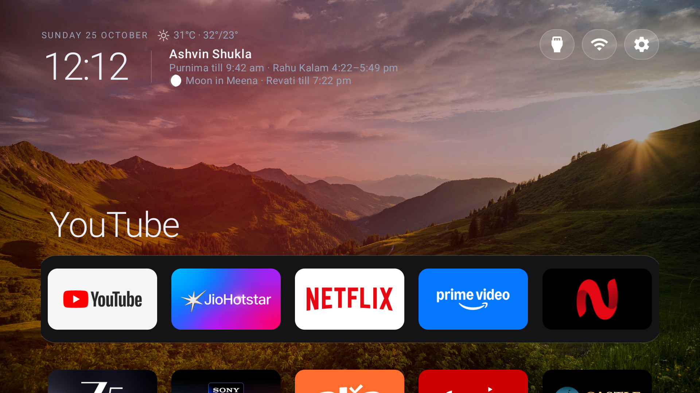

Raider is the launcher we use every day. Home is your apps, a clock, the weather, and the Hindu calendar. There is no recommendations row. Photos can fill the background. Settings are built for a remote on a 1080p set.

## Where it comes from

[CleanYourTV](https://github.com/Gathin23/cleanyourtv) by Gathin23 is the original project. It is a small native launcher, plus a careful way to disable manufacturer bloat without uninstalling it. Raider is a fork in the ordinary sense: the same launcher, carried on for home use. GitHub does not list this repository as a formal fork. The connection is this credit, the “Fork of CleanYourTV” line in About, and a git remote.

To follow upstream, add that remote once:

```bash
git remote add upstream https://github.com/Gathin23/cleanyourtv.git
```

In the app, About says **Made by apukale**.

Stock Android TV and Google TV put a recommendations row, and often an ad, between you and your apps. Raider replaces that home screen. It does not uninstall the apps that were already on the TV.

## How it was made

Raider is derived from [CleanYourTV](https://github.com/Gathin23/cleanyourtv) by Gathin23. The launcher that first drew this home screen came from that project.

From there it became the daily home screen on a real TCL Android TV 11: a G03_4K, 2 GB of RAM, 32-bit. Settings were rebuilt for a remote on a 1080p screen, one panel at a time: Home Layout, Appearance with seven named themes, Screensaver, Photos, Calendar & Clocks, Weather, Night Mode, Advanced, and About. That cut is **3.0.0**. **3.0.1** adds custom names for Home app tiles. Hold OK on a tile and choose Rename, or open Settings → Advanced → App names. The name stays on the TV. The package does not change.

There is no Play Store package. The release APK is signed with the debug key so a sideload can replace the copy already on the TV. In the app, About says **Made by apukale**.

## How Raider improves on stock Android TV and CleanYourTV

Stock Android TV and Google TV put a recommendations row, and often an ad, between you and your apps. Raider leaves that row out. Home can use a full-bleed photo. The clock, the weather, and a Panchang line sit on Home. World Clocks, Weather, Panchang, and the Screensaver each have their own screen. Night Mode dims the panel on a schedule. Clear cache and Free RAM are there for a low-RAM set, and Private DNS plus a Default Home helper sit under Advanced.

The core launcher, and the choice to disable bloat rather than uninstall it, still come from CleanYourTV. What 3.0 adds on that base:

- Settings rebuilt as a left rail and panels that fit one 1080p screen.
- Seven colour themes, by name: Indigo + Marigold, Midnight + Ice, Espresso + Amber, Forest + Mint, Plum + Orchid, Onyx + Crimson, and True Black + Silver.
- Home Layout opens on a 2×2: Weather, World clocks, Panchang, and Screensaver.
- Photo sources, with shuffle and one interval shared by Home and the screensaver.
- Hindu Panchang, and World Clocks City 1–4 in a 2×2. India stays the home clock.
- Weather from Open-Meteo. Clouds on the India map are optional, from OpenWeatherMap, when `OPENWEATHERMAP_API_KEY` is set in `launcher/local.properties`.
- Free RAM, Clear cache, and an About readout of free RAM and storage.
- The weather map framed on India.
- About, with a QR code for this GitHub page.
- Custom names for Home app tiles (3.0.1). Hold OK and choose Rename, or use Settings → Advanced → App names. Clear, a blank Save, or the original label puts that app's own name back. Reset all app names does that for every tile.

## Features

Shots below are from a TCL Android TV 11 running 3.0.0 (51). 3.0.1 (52) adds custom app names, which are not in these shots.

### Home

The top of Home is the time, the date, a one-line weather reading, and a short Panchang line (tithi, nakshatra, and yoga when the Hindu calendar is on). Under that, apps sit in rows. The number of apps in a row is a setting. Hold OK on a tile to choose the app logo or the banner for that app.

Inputs, Wi-Fi, and Settings sit in a short row on the right. Full-bleed photos rotate behind everything while Photos is on. While Photos is off, Home uses one gradient and does not advance.

Hold OK on a tile and choose Rename to replace that tile's label. The name is stored on the TV and comes back after a restart. It is the label on the tile and in the hero. The package is unchanged. The same dialog is under Settings → Advanced → App names.

### Home Layout

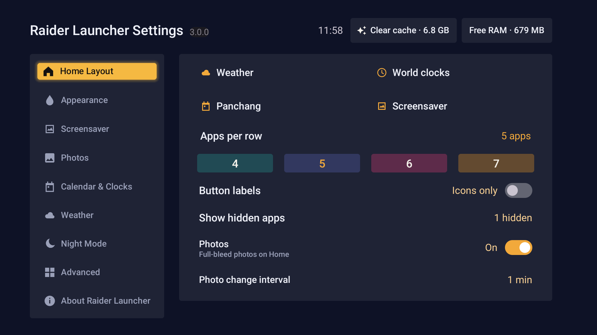

Settings → Home Layout opens with four blocks: Weather, World clocks, Panchang, and Screensaver. Each one opens that screen. They are not drawn on Home itself.

Under the blocks: apps per row (4, 5, 6, or 7 on this set), button labels for the Inputs / Wi-Fi / Settings row, unhide apps, Photos on or off, and how often the background changes. The same interval is used by the screensaver slideshow. Home shuffles the order, so a new session does not replay the same sequence. The interval row rests while Photos is off.

### Appearance

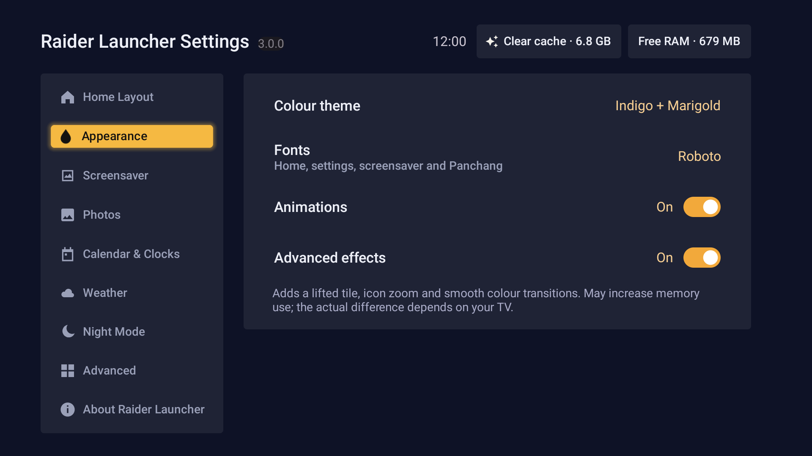

Seven colour themes:

- Indigo + Marigold
- Midnight + Ice
- Espresso + Amber
- Forest + Mint
- Plum + Orchid
- Onyx + Crimson
- True Black + Silver

Fonts can be set separately for Home, launcher settings, the screensaver, and Panchang. Outfit is the default. The chooser also has Sora, Sofia Sans, Nunito, Work Sans, Lexend, Atkinson Hyperlegible, Space Grotesk, Inter, Source Serif 4, Roboto, Poppins, Roboto Flex, and Manrope.

Animations can be turned off. Advanced effects add a lifted tile, icon zoom, and smoother colour changes. The settings screen says they may use more memory, and that the difference depends on the TV. Turning animations off also turns advanced effects off.

### Screensaver

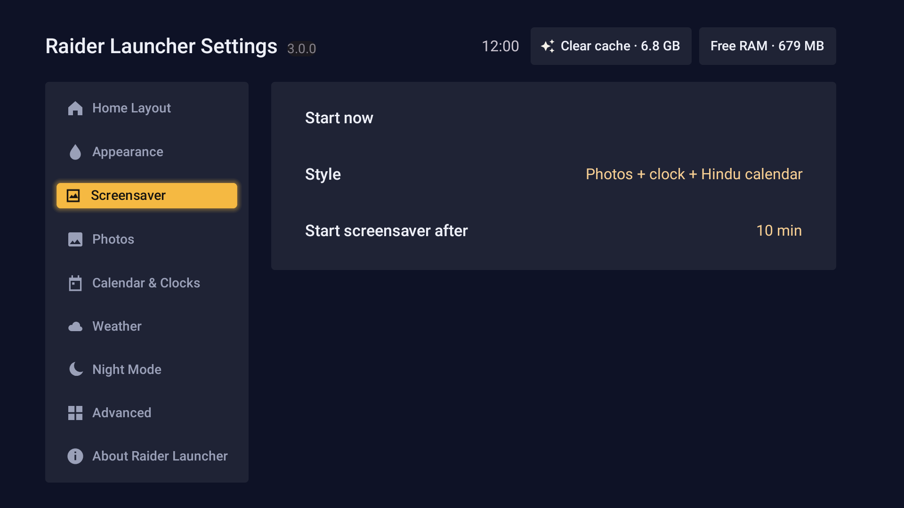

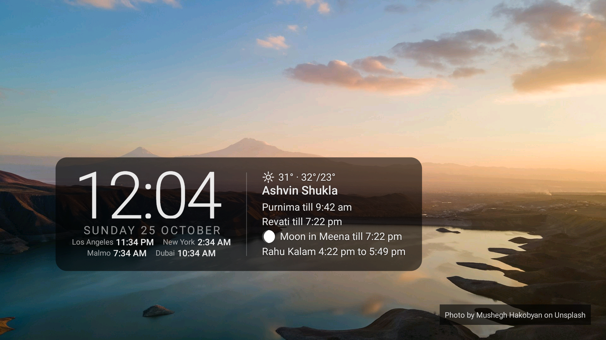

Start it now, or let it start after the TV has been idle (1 to 30 minutes, or never). The style is Clock, Clock with date, or Photos.

Photos come from the library in Photos settings. World clocks can be shown along the bottom. The Hindu calendar can stay on Home only, or on Home and the screensaver. A weather line can sit on the screensaver as well.

### Photos

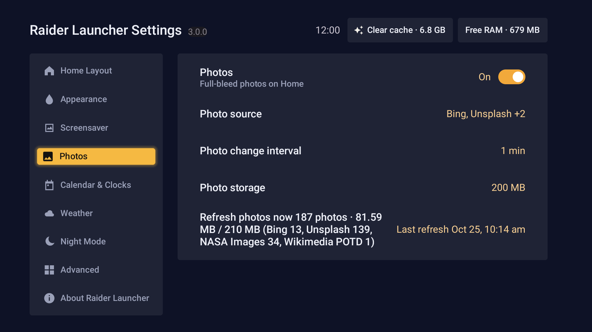

Photos are downloaded on the TV and shown from local storage. The master switch is here. Sources you can turn on:

- Bing
- Unsplash
- NASA APOD
- NASA Images
- Wikimedia POTD
- Pexels
- Pixabay
- Paintings (public-domain works from the Art Institute of Chicago and The Met)

Unsplash, Pexels, and Pixabay appear only when their keys are in `launcher/local.properties`. The file is not committed. Leave a key out and that source is skipped. Do not put a real key in the README or in git.

Each source refreshes about once a day on unmetered Wi-Fi, one download at a time. Storage can be capped at 100 MB, 200 MB, or 500 MB. Downloads stop if the data partition has less than 2 GB free. Unsplash photos keep the photographer credit.

### Calendar & Clocks

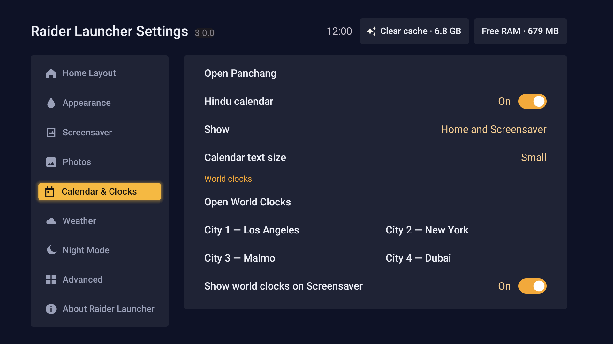

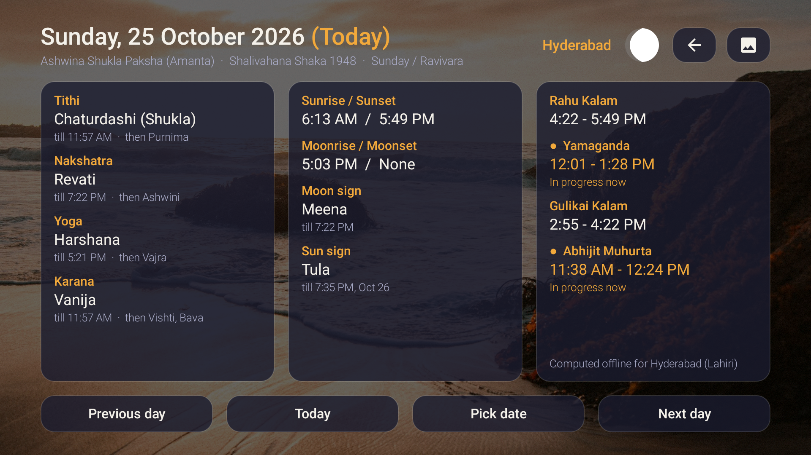

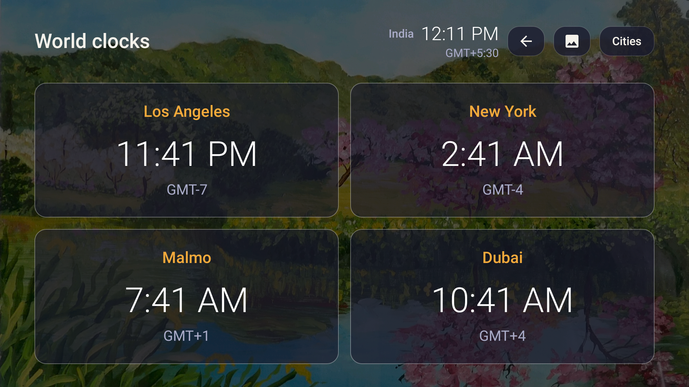

Open Panchang for the full Hindu day: tithi, nakshatra, yoga, karana, moon and sun rashis, and the Rahu Kala, Yamaganda, Gulika, and Abhijit periods. It is computed on the TV. The place follows the weather city.

The Hindu calendar can be turned off. Text size is a setting. Show is either Only Home, or Home and Screensaver.

World clocks keep India as the home clock. City 1–4 are a 2×2 in settings (Los Angeles, New York, London, and Dubai until you change them). Each city can be given another timezone or a shorter name. The World clocks screen shows India beside the title and the four cities in a 2×2, with the local time and the GMT offset. “Show world clocks on Screensaver” is its own switch.

### Weather

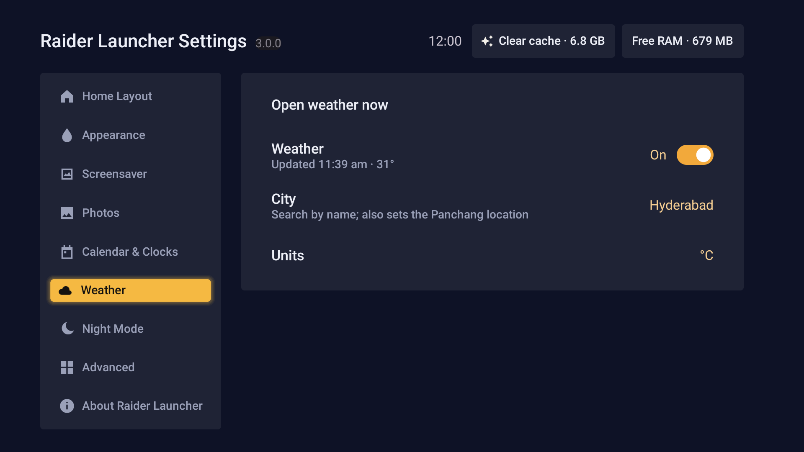

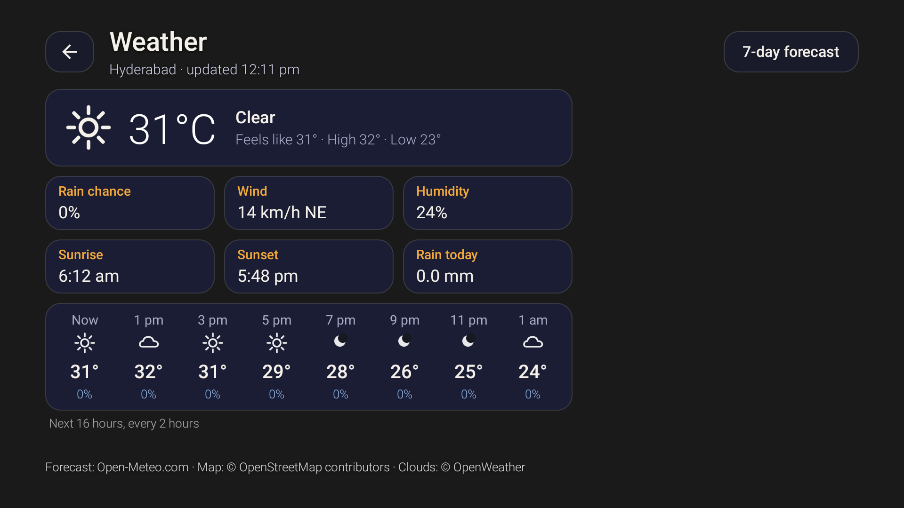
<!-- TODO: replace docs/screenshots/weather.png. This shot was taken before the India cloud map loaded, so the right side is blank. -->

The forecast comes from Open-Meteo for the city you pick. Search by name. That city is also the Panchang place. Units are °C or °F. The line on Home can be turned off.

The map is an India frame. Cloud cover on that map uses OpenWeatherMap when `OPENWEATHERMAP_API_KEY` is set in `launcher/local.properties` at build time. With no key, the map still draws and the corner note says the key is missing. The key stays in that local file.

### Night Mode

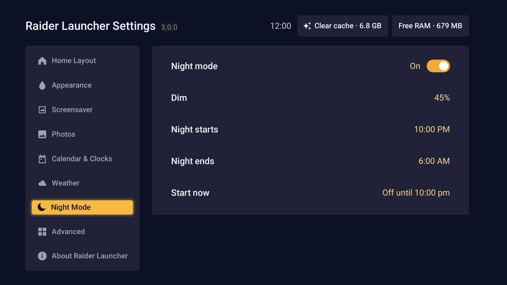

Night mode lowers the panel brightness on a schedule. You set the dim amount and the start and end times. Start now overrides the schedule until you stop it.

### Advanced

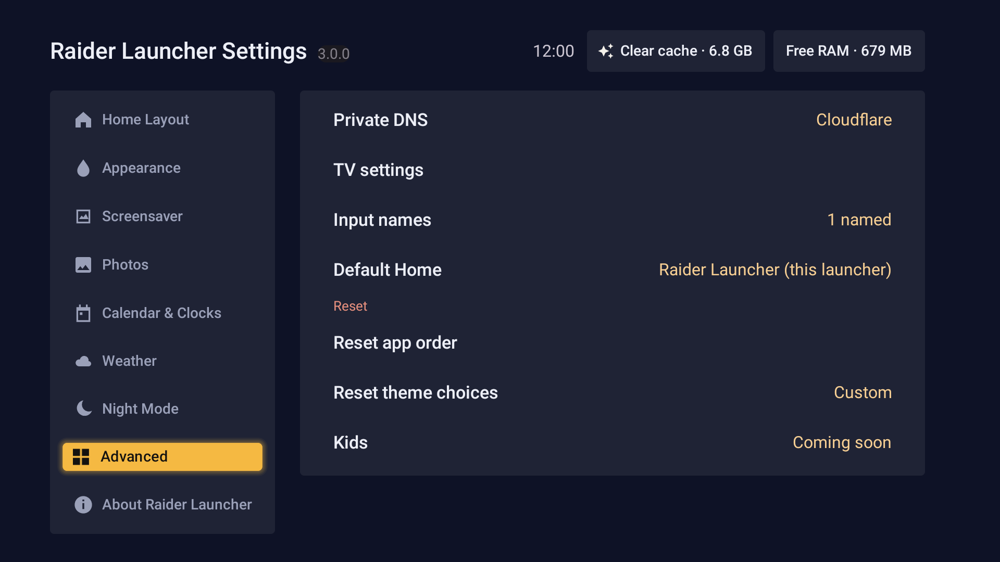

Clear cache frees cached data for apps on the TV. Free RAM closes background apps. Neither one removes apps, photos, or launcher settings. The same two actions sit at the top right of every settings screen.

Private DNS can be left off, set to Automatic, or pointed at a provider (AdGuard, Google, Cloudflare, Quad9, or a hostname you type). Writing that setting needs `android.permission.WRITE_SECURE_SETTINGS`, granted with adb if the TV asks.

App names lists every leanback app and the name you gave it. Reset all app names puts every tile back to its own name. A single name can also be cleared from the rename dialog.

Default Home sets this launcher as the home screen. You can also open the TV’s own settings, reset the app order, and send apps-per-row and animation choices back to the theme defaults. These rows open directly. There is no PIN. Kids is listed as coming soon.

### About

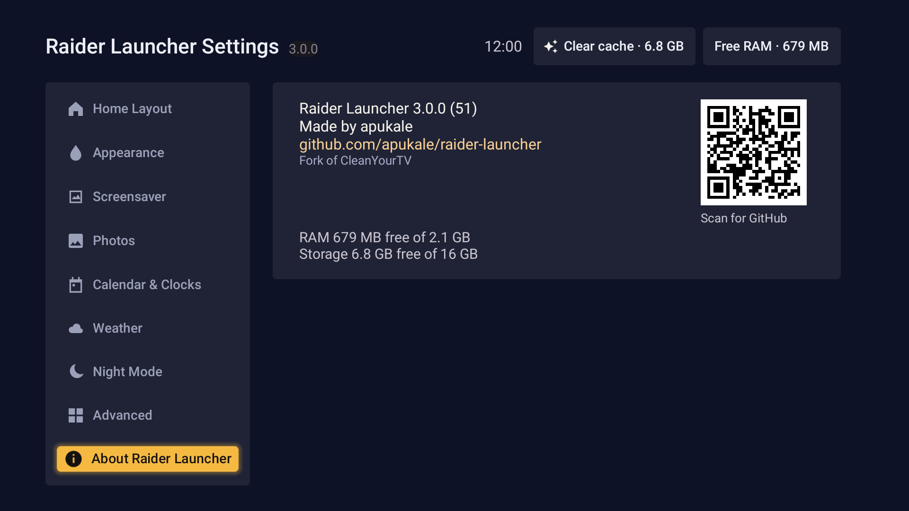

About shows the version and version code, “Made by apukale”, the GitHub link, a QR code for that link, and “Fork of CleanYourTV”. It also shows free RAM and storage.

## Tested on

TCL G03_4K, Android TV 11, 2 GB RAM, 32-bit (`armeabi-v7a`). The launcher targets that class of set: a 1080p screen and a remote, with settings pages that fit one screen.

## Build and install

The Android project is in `launcher/`. You need JDK 17 and Android SDK 34. Android Studio can open that folder, or from a terminal:

```bash
cd launcher
./gradlew :app:assembleRelease
```

The release APK is signed with the debug key so a sideload can replace a debug install. It is not a Play Store build. The APK is `launcher/app/build/outputs/apk/release/app-release.apk`.

Optional keys belong in `launcher/local.properties`, which is gitignored:

- `OPENWEATHERMAP_API_KEY` for the cloud layer
- `UNSPLASH_ACCESS_KEY`, `PEXELS_API_KEY`, `PIXABAY_API_KEY` for those photo sources
- `NASA_API_KEY` if you have one; NASA calls fall back to the public demo key when it is absent

Never commit those values.

## TV lists

The CleanYourTV package lists are still in this repo: [66 TV lists](examples/) for 66 TV models. Each folder holds a `debloat.txt` of packages to disable, not uninstall. Folder names and the longer notes live in [examples/README.md](examples/README.md). The same TVs are indexed here.

| TV | OS | List |
|---|---|---|
| AiPro2K (Expressluck, dongnae; Changhong AI PONT family) | Android TV 14 | [`aipro2k/`](examples/aipro2k/) |
| Amazon Fire TV Stick 4K, 1st gen 2018 (AFTMM, mantis) | Fire OS 6.7.1.1 / Android 7.1 | [`amazon-fire-tv-stick-4k-2018/`](examples/amazon-fire-tv-stick-4k-2018/) |
| BenQ E55-735 (Changhong AI PONT, DVB96BQ) | Google TV 14 | [`benq-e55-735/`](examples/benq-e55-735/) |
| CHiQ AI PONT (Changhong GTVU65, dangni, MediaTek mt5867) | Google TV 14 | [`chiq-gtvu65/`](examples/chiq-gtvu65/) |
| CHiQ AI PONT (DVB93CQ) | Android TV 11 | [`chiq-ai-pont/`](examples/chiq-ai-pont/) |
| Chromecast with Google TV 4K (sabrina) | Google TV 14 | [`google-chromecast-gtv-4k/`](examples/google-chromecast-gtv-4k/) |
| Hisense HiSmartTV A4 (xiaoyushan, MStar m7322), India | Android TV 9 | [`hisense-hismarttv-a4/`](examples/hisense-hismarttv-a4/) |
| Hisense SmartTV 4K FFM (huangshan, MediaTek) | Android TV 10 | [`hisense-smarttv-4k-ffm/`](examples/hisense-smarttv-4k-ffm/) |
| Hisense U75 (hengshan, MediaTek), Latin America | Google TV 12 | [`hisense-u75-hengshan/`](examples/hisense-u75-hengshan/) |
| Hitachi 65QLEDSM20 (MTC, bangbae, MediaTek m7322), Australia | Android TV 11 | [`hitachi-65qledsm20/`](examples/hitachi-65qledsm20/) |
| Insignia 55" F30 4K Fire TV (NS-55F301NA25, AFTDCT31, duckie) | Fire OS 7 / Android 9 | [`insignia-ns55f301na25/`](examples/insignia-ns55f301na25/) |
| NVIDIA SHIELD TV Pro 2019 (P2897, mdarcy) | Android TV 11 | [`nvidia-shield-tv-pro-2019/`](examples/nvidia-shield-tv-pro-2019/) |
| OnePlus TV (D00, Dubai) | Google TV 14 | [`oneplus-tv-dubai/`](examples/oneplus-tv-dubai/) |
| Panasonic 4KTV-JUP (Jupiter_PA, MediaTek) | Android TV 11 | [`panasonic-4ktv-jup/`](examples/panasonic-4ktv-jup/) |
| Philips 50PUS8517/12 (TP Vision, PH1M_EA_9970A, MediaTek MT5895), Europe | Android TV 11 | [`philips-50pus8517/`](examples/philips-50pus8517/) |
| Philips 55PUS7503/12 (TP Vision TPM171E, PH7M_EU_5596, MediaTek MT5891), Europe | Android TV 8.0 | [`philips-55pus7503/`](examples/philips-55pus7503/) |
| Philips R8G Google TV (MOKA, whitefield, Realtek RTD2851F), US | Google TV 14 | [`philips-r8g-google-tv/`](examples/philips-r8g-google-tv/) |
| Philips Smart 4K TV (Skyworth, eleonas, MediaTek), India | Google TV 14 | [`philips-smart-4k-google-tv/`](examples/philips-smart-4k-google-tv/) |
| PRISM+ Q65 Ultra 2026 QLED 4K AI Google TV (R10G, PRISMPLUS_FFM, MOKA, Realtek RTD2875 SoC, RTD6748 platform) | Google TV 14 | [`prismplus-q65-ultra-r10g/`](examples/prismplus-q65-ultra-r10g/) |
| RCA AI PONT SA (Changhong, redwood, ISDB92RC; also sold as realme 40-inch) | Android 14 | [`rca-ai-pont/`](examples/rca-ai-pont/) |
| Redmi TV (MiTV-ANTL0, starwars) | Android 5.1.1 (not Android TV) | [`redmi-mitv-antl0/`](examples/redmi-mitv-antl0/) |
| SANYO ATV R2 (SCBC, Realtek RTD285O) | Android TV 9 | [`sanyo-atv-r2/`](examples/sanyo-atv-r2/) |
| Skyworth SWTV-21AE (sunnyvale, MediaTek) | Android TV 14 | [`skyworth-swtv-21ae/`](examples/skyworth-swtv-21ae/) |
| Skyworth SWTV-24NA-4K NF (eleonas, MediaTek mt5896), US | Google TV 14 | [`skyworth-swtv-24na-4k-nf/`](examples/skyworth-swtv-24na-4k-nf/) |
| Sony BRAVIA 4K AE2 (BRAVIA_AE2, MediaTek MT5897), North America | Google TV 14 | [`sony-bravia-ae2/`](examples/sony-bravia-ae2/) |
| Sony BRAVIA 4K GB (BRAVIA_ATV2_EU, BRAVIA_ATV2) | Android TV 9 | [`sony-bravia-4k-gb/`](examples/sony-bravia-4k-gb/) |
| Sony BRAVIA 4K UR2 (BRAVIA_UR2_4K, MediaTek) | Android TV 10 | [`sony-bravia-4k-ur2/`](examples/sony-bravia-4k-ur2/) |
| Sony BRAVIA 4K VH2 (KD-55X80J, BRAVIA_VH2, MediaTek), EU | Google TV 12 | [`sony-bravia-4k-vh2/`](examples/sony-bravia-4k-vh2/) |
| Sony BRAVIA 9 II (K-65XR90M2, BRAVIA_AE3, MediaTek MT5838) | Google TV 14 | [`sony-bravia-9-ii/`](examples/sony-bravia-9-ii/) |
| Sony BRAVIA BF1 (BRAVIA 2 II class, BRAVIA_BF1_4K_A, MediaTek) | Google TV 12 | [`sony-bravia-bf1/`](examples/sony-bravia-bf1/) |
| Sony BRAVIA KD-55X85J (2021, BRAVIA_VH2, MediaTek MT5895), South America | Google TV 12 | [`sony-kd-55x85j/`](examples/sony-kd-55x85j/) |
| Sony BRAVIA KD-65X80J (2021, BRAVIA_VH2, MediaTek), India | Google TV 10 | [`sony-kd-65x80j/`](examples/sony-kd-65x80j/) |
| Sony BRAVIA XBR-65X900E (2017, BRAVIA_ATV2) | Android TV 9 | [`sony-xbr-x900e/`](examples/sony-xbr-x900e/) |
| Stellamore T950S projector (Droidlogic be30a3, Amlogic txhd2) | Android 13 | [`stellamore-t950s/`](examples/stellamore-t950s/) |
| TCL 40S5400A (C06, C06_2K_GB, MediaTek MT9221, 1 GB) | Android TV 11 | [`tcl-40s5400a/`](examples/tcl-40s5400a/) |
| TCL 43C645 (Smart TV Pro, Realtek RTD2851 / R51MT05, V8-R51MT05-LF1V652) | Google TV launcher on Android TV 11 | [`tcl-43c645/`](examples/tcl-43c645/) |
| TCL 50EP680 (Europe, BeyondTV, Realtek rtd285o) | Android TV 11 | [`tcl-50ep680/`](examples/tcl-50ep680/) |
| TCL 55" 4K Google TV, 2023 (G10, G10_4K_US_NF); also TCL 55P6K, Spain (G10_4K_GB_NF_32BIT) | Google TV 12 | [`tcl-g10-google-tv/`](examples/tcl-g10-google-tv/) |
| TCL 55Q10G Pro (China, tcl_mt5879_cn, MediaTek MT9952) | Android TV 11 | [`tcl-q10g-pro/`](examples/tcl-q10g-pro/) |
| TCL 65C725 (Smart TV Pro, BeyondTV4) | Android TV 11 | [`tcl-65c725/`](examples/tcl-65c725/) |
| TCL 65C735 (Smart TV Pro, G05, MediaTek), France | Google TV 11 | [`tcl-65c735/`](examples/tcl-65c735/) |
| TCL ak30a5 (China, Amlogic) | Android TV 9 | [`tcl-ak30a5/`](examples/tcl-ak30a5/) |
| TCL BeyondTV (India) | Android TV 9 | [`tcl-beyondtv/`](examples/tcl-beyondtv/) |
| TCL BeyondTV, EU/Nordic (Realtek RTD2851, V8-R851T02-LF1V606) | Android TV 9 | [`tcl-beyondtv-rt2851/`](examples/tcl-beyondtv-rt2851/) |
| TCL BeyondTV2 (Latin America / Brazil, Realtek RTD2851) | Android TV 9 | [`tcl-beyondtv2-latin-america/`](examples/tcl-beyondtv2-latin-america/) |
| TCL QM6K Pro, 2025 (G08, MediaTek tcl9618) | Google TV 14 | [`tcl-qm6k-google-tv/`](examples/tcl-qm6k-google-tv/) |
| TCL Smart TV Pro (G05, G05_4K_US, MediaTek MT5889) | Google TV 11 | [`tcl-g05-google-tv/`](examples/tcl-g05-google-tv/) |
| TCL UnionTV, Latin America (TCL-built like Thomson 32HE5800, Realtek RT2841) | Android TV 9 | [`tcl-uniontv-latin-america/`](examples/tcl-uniontv-latin-america/) |
| Thomson 32HE5800 (TCL-built UnionTV, Realtek RT2841), Spain | Android TV 9 | [`thomson-32he5800/`](examples/thomson-32he5800/) |
| Toshiba Fire TV (AFTHA004, hazel) | Fire OS 7 / Android 9 | [`toshiba-fire-tv-aftha004/`](examples/toshiba-fire-tv-aftha004/) |
| Vu 4K (HVCL, lushan, MediaTek), India | Google TV 12 | [`vu-4k-lushan/`](examples/vu-4k-lushan/) |
| XGIMI Horizon S Pro projector (XK03H, xgimigalileo, MediaTek) | Android TV 11 | [`xgimi-horizon-s-pro/`](examples/xgimi-horizon-s-pro/) |
| Xiaomi Mi Box S (MIBOX4, oneday), streaming box | Android TV 9 | [`xiaomi-mi-box-s/`](examples/xiaomi-mi-box-s/) |
| Xiaomi Mi Box S 2nd gen (MiTV-AFKR0, jaws), streaming box | Google TV 11 | [`xiaomi-mi-box-s-2nd-gen/`](examples/xiaomi-mi-box-s-2nd-gen/) |
| Xiaomi Mi TV (MiTV-MOOQ0, croods) | Android TV 10 | [`xiaomi-mitv-mooq0/`](examples/xiaomi-mitv-mooq0/) |
| Xiaomi Mi TV 4A (MiTV-MOOQ1) | Android TV 10 | [`xiaomi-mi-tv-4a/`](examples/xiaomi-mi-tv-4a/) |
| Xiaomi MiTV-AESP0 stick (aquaman, 1 GB) | Android TV 9 | [`xiaomi-mitv-aesp0/`](examples/xiaomi-mitv-aesp0/) |
| Xiaomi MiTV-ASTP1 (maverick), China firmware 2.40.641.0514.cn, 1 GB RAM, 720p | Android TV 9 (CN build) | [`xiaomi-mitv-astp1/`](examples/xiaomi-mitv-astp1/) |
| Xiaomi MiTV-AXFR1 (rango, Amlogic, 1 GB), India | Android TV 11 | [`xiaomi-mitv-axfr1/`](examples/xiaomi-mitv-axfr1/) |
| Xiaomi MiTV-AXSO0 (dangal; Mi TV 4C Pro 2019 / 4A Pro) | Android TV 9 | [`xiaomi-mitv-axso0/`](examples/xiaomi-mitv-axso0/) |
| Xiaomi MiTV-MOOR2 (venom, MediaTek) | Google TV 11 | [`xiaomi-mitv-moor2/`](examples/xiaomi-mitv-moor2/) |
| Xiaomi MiTV-MOSR4 (irobot, MediaTek) | Google TV 11 | [`xiaomi-mitv-mosr4/`](examples/xiaomi-mitv-mosr4/) |
| Xiaomi MiTV-MSSP3 (machuca, MediaTek) | Android TV 11 | [`xiaomi-mitv-mssp3/`](examples/xiaomi-mitv-mssp3/) |
| Xiaomi MiTV-MSSP3 (machuca, MediaTek), Android 9 firmware PI.7524 | Android TV 9 | [`xiaomi-mitv-mssp3-android9/`](examples/xiaomi-mitv-mssp3-android9/) |
| Xiaomi TV A Pro 75" 2026 (MiTV-MZTU0, river, MediaTek) | Google TV 14 | [`xiaomi-tv-a-pro-2026/`](examples/xiaomi-tv-a-pro-2026/) |
| Xiaomi TV Box S 3rd gen (MiTV-AFMU0, twilight, Amlogic), streaming box | Google TV 14 | [`xiaomi-mitv-afmu0/`](examples/xiaomi-mitv-afmu0/) |

## Credits and license

Raider Launcher is derived from [CleanYourTV](https://github.com/Gathin23/cleanyourtv) by Gathin23. Thank you for the launcher this one is built on. Track that repository with a git remote named `upstream`, as shown above.

The app credits **apukale**.

Licensed under the MIT License. See [LICENSE](LICENSE). Copyright (c) 2026 Gathin. The Outfit typeface is under the SIL Open Font License; see `launcher/FONT-LICENSE-OFL.txt`.
